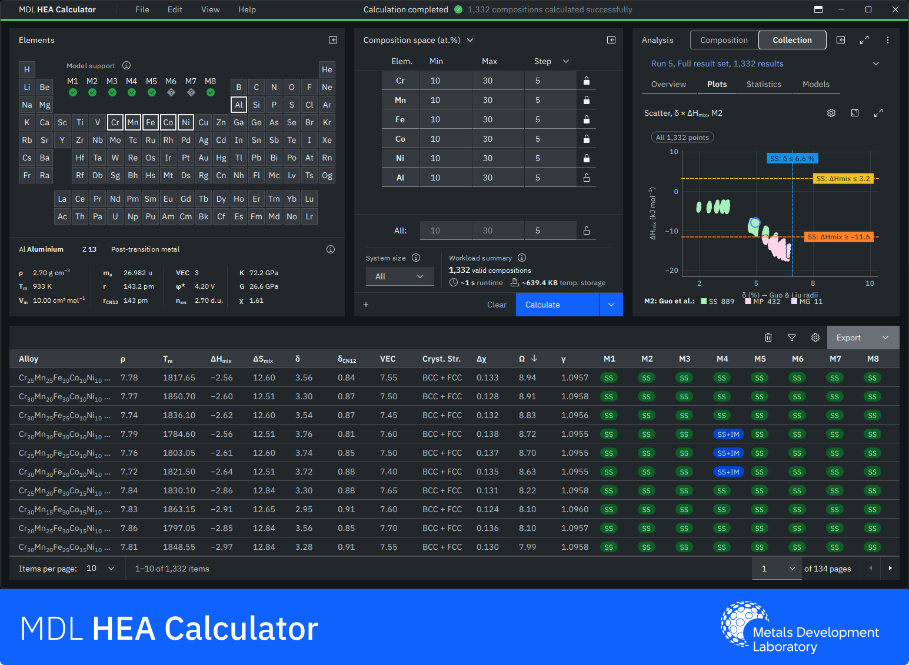
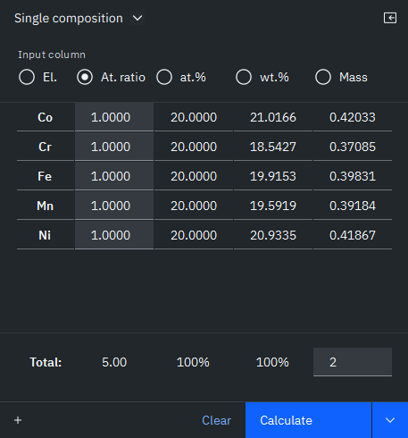
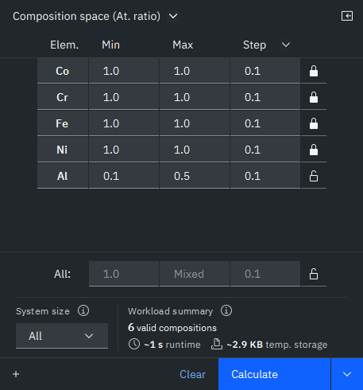
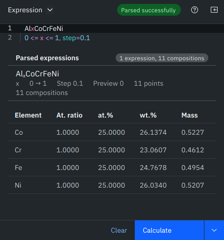
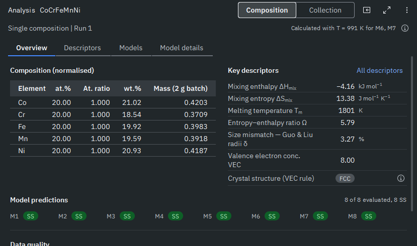
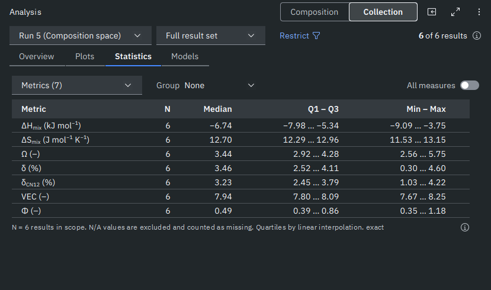

HEA Calculator is a desktop application for calculating the thermodynamic and atomic-size parameters of high-entropy
alloys (HEAs) and evaluating their tendency to form solid solutions. Eight published solid-solution formation
criteria are implemented.[^1][^2][^3][^4][^5][^6][^7][^8] The application can be used to compare individual alloys or
examine changes in the calculated parameters over a selected composition range. Such calculations
are useful in the initial selection of alloy compositions, particularly before experimental work or more detailed
CALPHAD and first-principles calculations.

A single calculation engine is used for individual compositions, composition spaces, parametric expressions and
compositions imported from spreadsheets. The equations, elemental properties, binary interaction data and limits
used in the calculations are documented in [`CALCULATION_AUDIT.md`](docs/CALCULATION_AUDIT.md). Reference values from
the original publications are also used in regression tests.

> [!IMPORTANT]
> The eight criteria are empirical or semi-empirical methods. An SS result indicates that the calculated
> parameters satisfy the solid-solution condition of the corresponding model. It does not necessarily mean that the
> alloy will form a single stable phase. Processing conditions, phase stability and transformation kinetics need to
> be considered separately. Further details are given in [Interpreting results](#interpreting-results).

## Features

Three methods are available for entering alloy compositions, depending on whether a single alloy or a range of
compositions is to be investigated.

| Single composition | Composition space | Composition expressions |
|---|---|---|
|  |  |  |

- **Single compositions.** Element amounts can be entered as atomic ratios, at.%, wt.% or mass. The remaining units
  are converted automatically.
- **Composition spaces.** A minimum, maximum and step size, or a number of points, can be defined for each element.
  Optional elements and a system-size filter can be used to include smaller alloy systems.
- **Composition expressions.** Parametric compositions, such as `AlxCoCrFeNi`, are defined using expressions and
  parameter ranges. Multiple expression blocks are supported, and repeated compositions are removed.
- **Spreadsheet import.** Compositions can also be imported from `.xlsx`, `.xlsm` and `.csv` files. The files may
  contain either a column of alloy formulas or separate columns for the elements. If a row cannot be interpreted, the
  reason is reported without preventing the remaining valid rows from being calculated.
- **Batch calculation and result storage.** Batch calculations are performed using background worker processes, with
  up to eight workers. The calculated results are written to a temporary SQLite database in portions rather than
  keeping the complete dataset in memory. The accepted upper limit is 10,000,000 compositions per batch. The results
  table reads the database in pages and provides sorting, filtering and optional columns.
- **Analysis and visualization.** Composition analysis shows the normalized composition in the supported units, the
  calculated descriptors with their full numerical values, and the classification, criterion and possible limitations
  of each model. Reasons for N/A results are included. Collection analysis provides statistical results and scatter,
  line, histogram, box, heatmap and class-count plots for a calculation batch. Missing numerical values are counted separately; they are not included as zeros in the
  plots or statistical calculations.
- **Export.** The complete set of results, or the results remaining after filtering, can be exported to Excel or CSV.
  Numerical values are exported at full precision. When the number of rows exceeds the Excel limit, the output is
  divided between files or written to CSV rather than omitting rows. Reports for individual compositions and
  collections can be saved as PDF. Statistical tables and plotted data can be exported to CSV, while the figures can
  be saved as SVG or PNG. The session database is temporary; results that need to be kept should therefore be
  exported.
- **Light and dark themes.** The application includes light and dark themes, an option to follow the Windows theme,
  undo and redo, keyboard shortcuts and panels that can be collapsed. Its colours, typography, icons and interaction
  states are based on the [Carbon Design System](https://carbondesignsystem.com/) v11 and implemented as Qt widgets.
  The application is not an IBM product and does not use Carbon's web components.

Before starting a calculation, the application indicates which models have sufficient data for the elements selected.
For composition spaces and other batches, it also determines the number of compositions and estimates the calculation
time and temporary disk-space requirement.

| Composition analysis | Collection analysis |
|---|---|
|  |  |

## Descriptors and models

The calculations are based on normalized atomic fractions. The calculated quantities ($\Delta S_{\mathrm{mix}}$,
$\Delta H_{\mathrm{mix}}$, $T_{\mathrm{m}}$, $\rho$, VEC, $\delta$, $\delta_{\mathrm{CN12}}$, the Pauling
electronegativity difference $\Delta\chi$ (used by no model) and the model parameters), their equations and data
sources[^9][^10][^11][^12][^13][^14] are listed in
[Phase-formation models](hea_calc/docs/pages/phase-models.md#calculated-quantities).

Two atomic-radius datasets[^9][^12] are used because the models were developed with different definitions of atomic
size. Using one common radius set would change the calculated values and, consequently, could affect the resulting
classifications. The remaining symbols, their units and definitions are given under
[Symbols, parameters and units](hea_calc/docs/pages/symbols.md).

### Phase-formation criteria

The eight criteria and the conditions implemented in the calculation engine are given below. Their numerical limits
are retained from the corresponding publications.

| | Publication | Criterion (as implemented) | Classes |
|---|---|---|---|
| **M1** | [^1] | SS if $\Omega \ge 1.1$ and $\delta_{\mathrm{CN12}} \le 6.6$ % | SS, MP |
| **M2** | [^2] | SS if $\delta \le 6.6$ % and $-11.6 \le \Delta H_{\mathrm{mix}} \le 3.2$ kJ mol⁻¹; MG if $\delta \gt 6.4$ % and $\Delta H_{\mathrm{mix}} \lt -12.2$ kJ mol⁻¹ | SS, MG, MP |
| **M3** | [^3] | SS if $\gamma \lt 1.175$ | SS, MP |
| **M4** | [^4] | SS if $\Lambda \gt 0.96$; SS+IM if $0.24 \le \Lambda \le 0.96$; IM if $\Lambda \lt 0.24$ | SS, SS+IM, IM |
| **M5** | [^5] | SS if $\phi \ge 20$ | SS, MP |
| **M6** | [^6] | SS if $-T\Delta S_{\mathrm{mix}} \lt \Delta H_{\mathrm{f}}(i,j) \lt 37$ meV/atom for every pair | SS, IM, MP |
| **M7** | [^7] | SS if $\Delta H_{\mathrm{mix}} - T\Delta S_{\mathrm{mix}} \lt \Delta H_{\mathrm{IM}} - k_2 T\Delta S_{\mathrm{mix}}$, $k_2 = 0.6$ | SS, IM |
| **M8** | [^8] | SS if $\Phi \ge 1$, with $\Phi$ from Miedema-model $\Delta G_{\mathrm{ss}}$ and $\Delta G_{\max}$ | SS, MP |

The classes are SS (solid solution), MP (multiple phases, or not classified as a single solid solution), IM
(intermetallic), SS+IM (solid solution with intermetallic), and MG (metallic glass). N/A indicates that the model
could not be evaluated. The full equations of the descriptors and criteria are given in Sections 3 and 4 of
[`CALCULATION_AUDIT.md`](docs/CALCULATION_AUDIT.md#3-thermodynamic-and-atomic-size-descriptors).

For M6 and M7, the default temperature is $0.55\thinspace T_{\mathrm{m}}$. This value can be replaced by an annealing
temperature in *Calculation settings*. The binary formation enthalpies required by M6 were taken from the supplementary matrix of
the publication.[^6] The Miedema parameters used for M8 are taken from the published tables.[^11][^14]

A number of decisions were necessary when the published criteria were implemented, for example the treatment of
inclusive and strict numerical boundaries. They are summarized under
[Implementation decisions](hea_calc/docs/pages/phase-models.md#implementation-decisions), and their sources and the
reasons for the decisions are discussed in [`CALCULATION_AUDIT.md`](docs/CALCULATION_AUDIT.md).

## Validation

Regression tests were prepared using numerical values reported in the original publications. The test files are in
[`tests/`](tests), and the transcribed reference data are in [`tests/reference/`](tests/reference). They include
Table 1 of the M1, M2 and M4 publications,[^1][^2][^4] the excess-entropy values of M5,[^5] the
$\Delta H_{\mathrm{IM}}$ values of M7,[^7] and the worked examples of M8.[^8]

For M7, 44 out of 45 reported $\Delta H_{\mathrm{IM}}$ values were reproduced. In addition, the 840 transition-metal
pairs of Bakker's Table A2[^11] were reproduced within ±2.1 kJ mol⁻¹. The validation results are summarized in
[Section 6](docs/CALCULATION_AUDIT.md#6-validation-against-published-results) of `CALCULATION_AUDIT.md`, and the remaining
differences from the published values, together with their possible causes, in
[Section 7](docs/CALCULATION_AUDIT.md#7-known-discrepancies-and-scientific-limitations).

## Installation

Version 1.0.0rc1 is a release candidate, and a compiled installer has not been published. The application can be run
from source. Versioning is described in [`CONTRIBUTING.md`](CONTRIBUTING.md#versioning).

- **Tested:** Windows 11 and Linux. The application has been launched and used interactively on both platforms, and
  the test suite has been run on Linux. On Windows 11, display scaling was tested at 125 % on a physical 2160 × 1440
  display, and at 100 % and 150 % under controlled emulation. Windows-specific window features, such as Snap Layouts,
  and the native-window tests were checked on Windows only. Python 3.11 and PySide6 6.7.3 are the pinned application
  environment.
- **Not yet tested:** Windows 10 and macOS. Windows-specific functionality is guarded in the code, but operation on
  macOS has not been verified.
- **Not included:** There is currently no command-line interface or Python API. Calculations are carried out through
  the desktop interface.

Batch calculations also require temporary disk space, which is estimated before the calculation begins.

The project is managed with [uv](https://docs.astral.sh/uv/). `uv sync` installs Python 3.11 (pinned in
`.python-version`) if needed and creates `.venv` with the exact dependency versions recorded in `uv.lock`.

```powershell
git clone https://github.com/aliferdem/mdl-hea-calculator.git hea-calculator
cd hea-calculator
uv sync
uv run main.py
```

Without uv, the same versions can be installed with pip:

```powershell
py -3.11 -m venv .venv
.venv\Scripts\python -m pip install -r requirements.txt
.venv\Scripts\python main.py
```

The dependencies are declared in `pyproject.toml`. PySide6 is pinned to version 6.7.3, while openpyxl and
XlsxWriter are used for spreadsheet import and Excel export, respectively. pytest and matplotlib are development
tools, which are not required at runtime; `uv sync` installs them by default. Nuitka builds the portable app (a .zip
on Windows, a .tar.gz on Linux) with `uv run --group build tools/build.py`. After a dependency change in
`pyproject.toml`, `uv lock` updates `uv.lock`, and `requirements.txt` is regenerated with the command recorded at the
top of that file.

## Quick start

As a first example, select Co, Cr, Fe, Mn and Ni from the periodic table. Leave the atomic ratio of each element
at 1 and press **Calculate**. For the equiatomic CoCrFeMnNi alloy, the following values are obtained:
$\Delta H_{\mathrm{mix}} = -4.16$ kJ mol⁻¹, $\Delta S_{\mathrm{mix}} = 13.38$ J mol⁻¹ K⁻¹, $\Omega = 5.79$,
$\delta = 3.27$ %, and VEC = 8.0, corresponding to the FCC classification of the VEC rule. All eight models return SS for this composition.

A different result is obtained for AlCoCrFeNi, for which BCC and B2 phases have been experimentally reported. The
model classifications are shown below.

| M1 | M2 | M3 | M4 | M5 | M6 | M7 | M8 |
|:--:|:--:|:--:|:--:|:--:|:--:|:--:|:--:|
| SS | MP | SS | SS+IM | MP | IM | IM | MP |

It is seen that the criteria do not give the same result for this alloy. This is because they were developed using
different datasets, assumptions and limits. The individual results should therefore be examined rather than treating
the eight classifications as a single phase prediction.

More detailed instructions are available in the documentation pages for the
[first calculation](hea_calc/docs/pages/first-calculation.md),
[composition space](hea_calc/docs/pages/composition-space.md),
[expression syntax](hea_calc/docs/pages/expression-syntax.md) and
[spreadsheet import](hea_calc/docs/pages/importing.md).

## Interpreting results

The calculated parameters and model classifications should be considered as preliminary indicators of phase
formation. Each model was developed from a limited set of alloys, mainly in as-cast or annealed conditions. Thus,
the classifications do not replace an examination of equilibrium phase stability, transformation kinetics or the
effect of processing conditions. Satisfying one of the empirical or semi-empirical solid-solution criteria is not
equivalent to predicting a stable single-phase alloy.

Several points are important when examining the results:

- **MP** indicates that the criterion for a single solid solution was not satisfied. It does not determine which
  additional phases are present.
- **N/A** indicates that a calculation could not be completed, rather than a predicted phase. The reason is given in
  *Analysis › Models*.
- Binary interaction data are used in the calculations. The formation of ternary or higher-order compounds is not
  considered explicitly.
- Results marked *Extrapolated* or *Flagged binary data* require additional caution, since the criterion was applied
  outside its stated range or uses a flagged data value.
- The availability of elemental data does not mean that the model has been experimentally validated for every alloy
  containing those elements.
- Numerical values in the results table are rounded for readability. The calculations and boundary comparisons use
  full precision. Full numerical values are available in exports and *Analysis › Descriptors*.

For further explanation, see [Scope and scientific limitations](hea_calc/docs/pages/scope.md),
[Result labels](hea_calc/docs/pages/result-labels.md),
[Binary interaction data](hea_calc/docs/pages/binary-data.md) and
[Elemental data](hea_calc/docs/pages/elemental-data.md).

## Documentation

- [In-app documentation](hea_calc/docs/pages) (*Help › Documentation*): calculations, models, data, results, exports
  and keyboard shortcuts. Links between pages use the internal `help://` scheme and work only inside the application.
- [Phase-formation models](hea_calc/docs/pages/phase-models.md): equations, numerical limits and limitations of the
  eight models.
- [`CALCULATION_AUDIT.md`](docs/CALCULATION_AUDIT.md): sources of equations and data, implementation decisions, validation
  and remaining differences from published values. Its development history is kept in
  [`docs/SCIENTIFIC_DEVELOPMENT_HISTORY.md`](docs/SCIENTIFIC_DEVELOPMENT_HISTORY.md).
- [`CONTRIBUTING.md`](CONTRIBUTING.md): architecture, tests, developer tools, dependency updates and versioning.

## Origins and acknowledgements

HEA Calculator was developed from [HEACalculator](https://github.com/dogusariturk/HEACalculator), an open-source
Python application by Doğuhan Sarıtürk, distributed under GPL-3.0. The original application calculates a related
set of thermodynamic parameters and solid-solution formation criteria. The present project started in 2024 as an
adaptation of that work. During subsequent development, the calculation engine, datasets, composition-input methods
and interface were rewritten. The numerical results were then checked against the corresponding publications, while
the original HEACalculator was retained as a reference implementation. Copyright in the original project remains
with its author.

Development takes place at the Metals Development Laboratory (MDL), Department of Metallurgical and Materials
Engineering, Middle East Technical University (METU), Ankara. The scientific models and source data are based on
the publications cited in the footnotes.

Special thanks to [Arif Enes Aydın](https://github.com/ae-aydin) for his assistance throughout the development of
HEA Calculator, and to [Taner Göktuğ Tekin](https://github.com/tekintaner) for the initial implementation of
composition import and the evaluation of model performance scores.

## Citing

HEA Calculator does not currently have a DOI. Until an archived version is available, it can be referenced using
the software name, version and repository URL; [`CITATION.cff`](CITATION.cff) provides this information, and GitHub
shows it under *Cite this repository*. The publications corresponding to the reported models
should also be cited, together with the data sources where relevant. They are listed in the footnotes.

The original HEACalculator should be cited alongside this project when the software is used in scientific work. For
the original HEACalculator, the following references are provided:

> D. Sarıtürk, Y.E. Kalay, R. Arróyave, HEACalculator: An open-source Python tool for thermodynamic property
> calculation and solid solution prediction in high-entropy alloys, arXiv (2026).
> [https://doi.org/10.48550/arXiv.2606.19661](https://doi.org/10.48550/arXiv.2606.19661)
>
> D. Sarıtürk, HEACalculator, Zenodo (2019). [https://doi.org/10.5281/zenodo.3590318](https://doi.org/10.5281/zenodo.3590318)

## License

HEA Calculator is distributed under version 3 of the GNU General Public License (GPL-3.0). The licence is provided
in [`LICENSE.txt`](LICENSE.txt). The software is supplied without warranty. The licences of the third-party
components are in [`THIRD-PARTY-NOTICES.txt`](THIRD-PARTY-NOTICES.txt).

[^1]: X. Yang, Y. Zhang, Prediction of high-entropy stabilized solid-solution in multi-component alloys, Mater. Chem.
    Phys. 132 (2012) 233–238.
    [https://doi.org/10.1016/j.matchemphys.2011.11.021](https://doi.org/10.1016/j.matchemphys.2011.11.021).
[^2]: S. Guo, Q. Hu, C. Ng, C.T. Liu, More than entropy in high-entropy alloys: Forming solid solutions or amorphous
    phase, Intermetallics 41 (2013) 96–103.
    [https://doi.org/10.1016/j.intermet.2013.05.002](https://doi.org/10.1016/j.intermet.2013.05.002).
[^3]: Z. Wang, Y. Huang, Y. Yang, J. Wang, C.T. Liu, Atomic-size effect and solid solubility of multicomponent alloys,
    Scr. Mater. 94 (2015) 28–31.
    [https://doi.org/10.1016/j.scriptamat.2014.09.010](https://doi.org/10.1016/j.scriptamat.2014.09.010).
[^4]: A.K. Singh, N. Kumar, A. Dwivedi, A. Subramaniam, A geometrical parameter for the formation of disordered solid
    solutions in multi-component alloys, Intermetallics 53 (2014) 112–119.
    [https://doi.org/10.1016/j.intermet.2014.04.019](https://doi.org/10.1016/j.intermet.2014.04.019).
[^5]: Y.F. Ye, Q. Wang, J. Lu, C.T. Liu, Y. Yang, Design of high entropy alloys: A single-parameter thermodynamic rule,
    Scripta Materialia 104 (2015) 53–55.
    [https://doi.org/10.1016/j.scriptamat.2015.03.023](https://doi.org/10.1016/j.scriptamat.2015.03.023).
[^6]: M.C. Troparevsky, J.R. Morris, P.R.C. Kent, A.R. Lupini, G.M. Stocks, Criteria for Predicting the Formation of
    Single-Phase High-Entropy Alloys, Phys. Rev. X 5 (2015) 011041.
    [https://doi.org/10.1103/PhysRevX.5.011041](https://doi.org/10.1103/PhysRevX.5.011041).
[^7]: O.N. Senkov, D.B. Miracle, A new thermodynamic parameter to predict formation of solid solution or intermetallic
    phases in high entropy alloys, J. Alloys Compd. 658 (2016) 603–607.
    [https://doi.org/10.1016/j.jallcom.2015.10.279](https://doi.org/10.1016/j.jallcom.2015.10.279).
[^8]: D.J.M. King, S.C. Middleburgh, A.G. McGregor, M.B. Cortie, Predicting the formation and stability of single phase
    high-entropy alloys, Acta Materialia 104 (2016) 172–179.
    [https://doi.org/10.1016/j.actamat.2015.11.040](https://doi.org/10.1016/j.actamat.2015.11.040).
[^9]: S. Guo, C.T. Liu, Phase stability in high entropy alloys: Formation of solid-solution phase or amorphous phase,
    Progress in Natural Science: Materials International 21 (2011) 433–446.
    [https://doi.org/10.1016/S1002-0071(12)60080-X](https://doi.org/10.1016/S1002-0071%2812%2960080-X).
[^10]: A. Takeuchi, A. Inoue, Classification of Bulk Metallic Glasses by Atomic Size Difference, Heat of Mixing and
    Period of Constituent Elements and Its Application to Characterization of the Main Alloying Element, Materials
    Transactions 46 (2005) 2817–2829.
    [https://doi.org/10.2320/matertrans.46.2817](https://doi.org/10.2320/matertrans.46.2817).
[^11]: H. Bakker, Enthalpies in Alloys: Miedema’s Semi-empirical Model, Trans Tech Publications, Zürich, 1998.
[^12]: C. Kittel, Introduction to Solid State Physics, 8th ed., John Wiley & Sons, Hoboken, NJ, 2005.
[^13]: S. Guo, C. Ng, J. Lu, C.T. Liu, Effect of valence electron concentration on stability of fcc or bcc phase in high
    entropy alloys, Journal of Applied Physics 109 (2011) 103505.
    [https://doi.org/10.1063/1.3587228](https://doi.org/10.1063/1.3587228).
[^14]: F.R. de Boer, R. Boom, W.C.M. Mattens, A.R. Miedema, A.K. Niessen, Cohesion in Metals: Transition Metal Alloys,
    North-Holland, Amsterdam, 1988.
