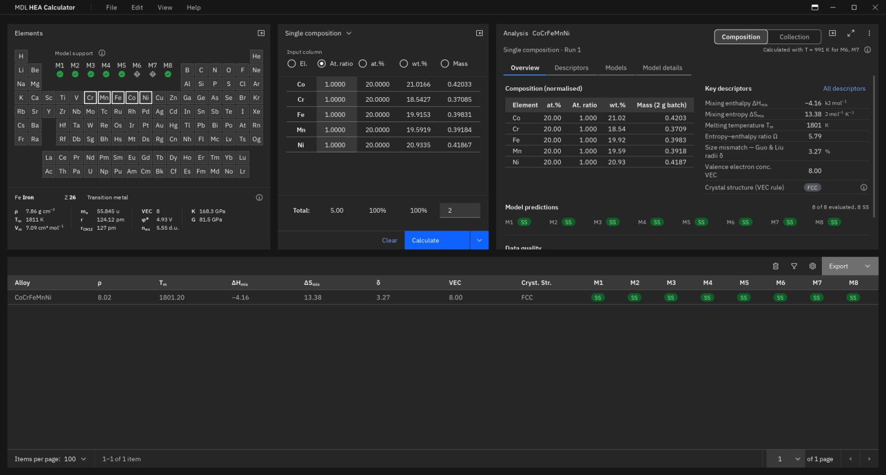
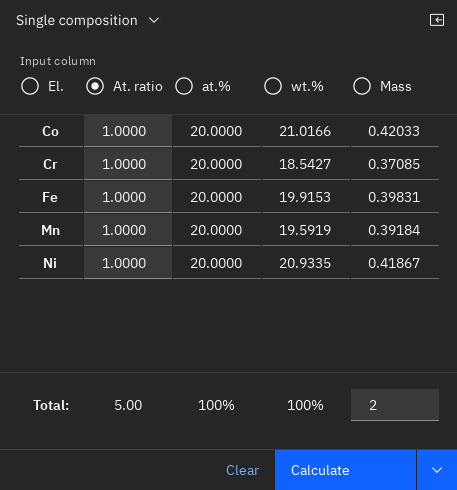
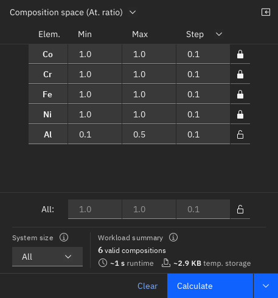
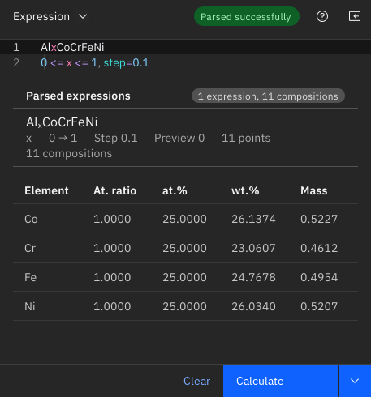
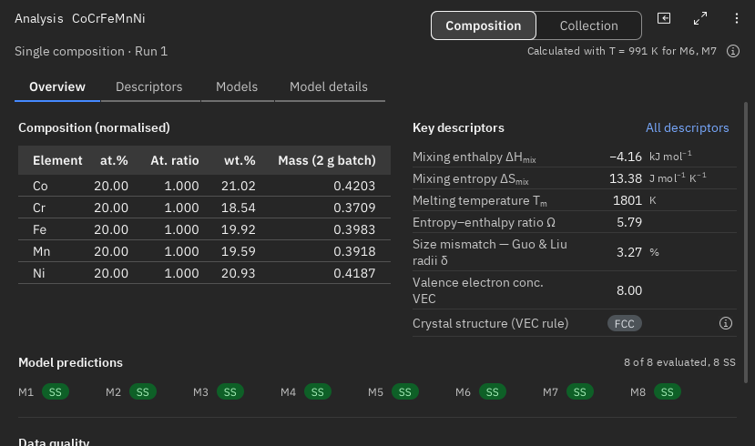
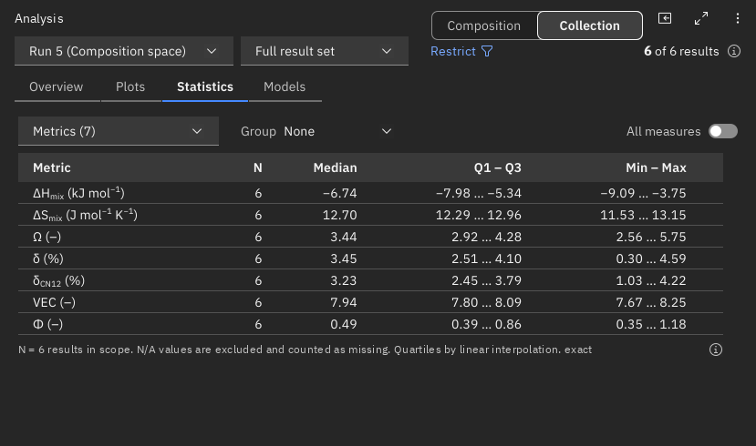
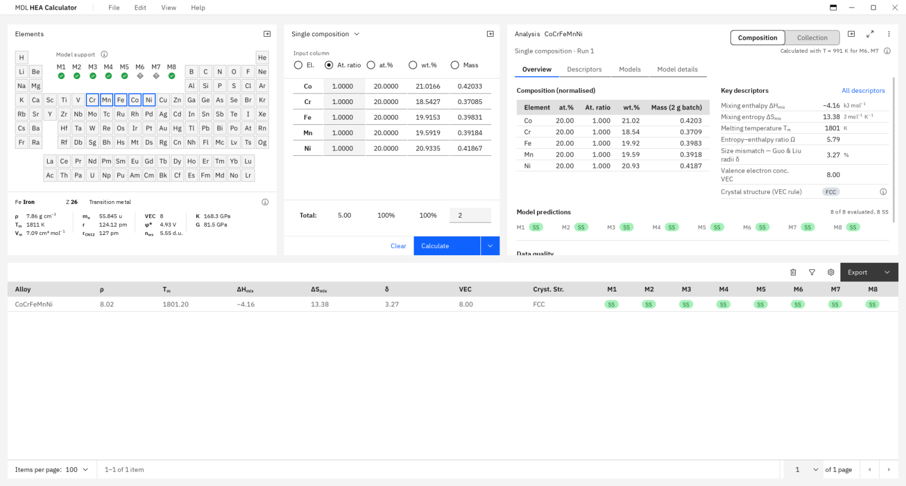
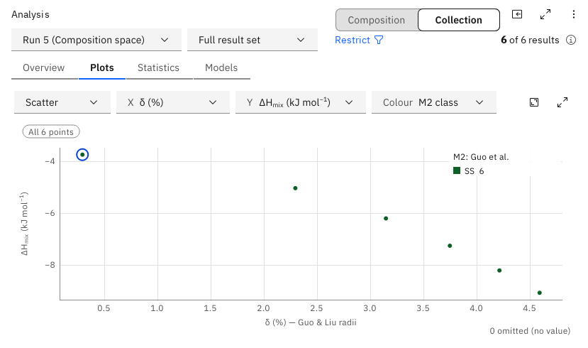

<div align="center">

# HEA Calculator

**Calculation of alloy descriptors and evaluation of eight published solid-solution formation criteria.**

[](LICENSE.txt)


[Features](#features) · [Science](#descriptors-and-models) · [Installation](#installation) ·
[Quick start](#quick-start) · [Limitations](#interpreting-results) · [Citing](#citing)

</div>

<picture>
  <source media="(prefers-color-scheme: light)" srcset="docs/screenshots/light/main-window.png">
  
</picture>

HEA Calculator is a desktop application for calculating the thermodynamic and atomic-size parameters of high-entropy
alloys (HEAs) and evaluating their tendency to form solid solutions. Eight criteria reported by Yang and Zhang, Guo,
Wang, Singh, Ye, Troparevsky, Senkov and Miracle, and King are included. The application can be used to compare
individual alloys or examine changes in the calculated parameters over a selected composition range. Such calculations
are useful in the initial selection of alloy compositions, particularly before experimental work or more detailed
CALPHAD and first-principles calculations.

A single calculation engine is used for individual compositions, composition spaces, parametric expressions and
compositions imported from spreadsheets. The equations, elemental properties, binary interaction data and limits
used in the calculations are documented in [`CALCULATION_AUDIT.md`](CALCULATION_AUDIT.md). Reference values from
the original publications are also used in regression tests.

> [!IMPORTANT]
> The eight criteria are empirical or semi-empirical methods. An **SS** result indicates that the calculated
> parameters satisfy the solid-solution condition of the corresponding model. It does not necessarily mean that the
> alloy will form a single stable phase. Processing conditions, phase stability and transformation kinetics need to
> be considered separately. Further details are given in [Interpreting results](#interpreting-results).

## Status

Version 1.0.0 is currently a pre-release, and a compiled installer has not been published. The application can be
run from source.

| | |
|---|---|
| **Tested** | Windows 11 with Python 3.11 and PySide6 6.7.3. Display scaling was tested at 125 % on a physical 2160 × 1440 display, and at 100 % and 150 % under controlled emulation |
| **Not yet tested** | Windows 10, macOS and Linux have not been tested. Windows-specific functionality is guarded in the code, but operation on macOS and Linux has not been verified |
| **Not included** | There is currently no command-line interface or Python API. Calculations are carried out through the desktop interface |

## Features

### Defining compositions

Three methods are available for entering alloy compositions, depending on whether a single alloy or a range of
compositions is to be investigated.

<table>
  <tr>
    <td width="33%"></td>
    <td width="33%"></td>
    <td width="33%"></td>
  </tr>
  <tr>
    <td><b>Single composition</b><br>Element amounts can be entered as atomic ratios, at.%, wt.% or mass. The remaining units are converted automatically. <i>Set equal</i> and <i>Normalize</i> are available for adjusting the composition.</td>
    <td><b>Composition space</b><br>A minimum, maximum and step size, or a number of points, can be defined for each element. Atomic ratio, at.%, wt.% and mass are supported. Optional elements and a system-size filter can be used to include smaller alloy systems.</td>
    <td><b>Composition expressions</b><br>Parametric compositions, such as <code>AlxCoCrFeNi</code>, are defined using expressions and parameter ranges. Multiple expression blocks are supported, and repeated compositions are removed. The editor also provides syntax highlighting and error messages.</td>
  </tr>
</table>

Compositions can also be imported from `.xlsx`, `.xlsm` and `.csv` files. The files may contain either a column of
alloy formulas or separate columns for the elements. If a row cannot be interpreted, the reason is reported without
preventing the remaining valid rows from being calculated.

Before starting a calculation, the available elemental data can be examined in the periodic table. The application
indicates which models have sufficient data for the elements selected. For composition spaces and other batches, it
also determines the number of compositions and estimates the calculation time and temporary disk-space requirement.

### Calculating and storing results

Batch calculations are performed using background worker processes, with up to eight workers. The calculated results
are written to a temporary SQLite database in portions rather than keeping the complete dataset in memory. This
allows the interface to remain responsive while calculations are running. The accepted upper limit is 10,000,000
compositions per batch.

The results table reads the database in pages and provides sorting, filtering and optional columns. Its header remains
visible while scrolling, and the classifications obtained from the models are displayed with colour-coded labels.

The complete set of results, or the results remaining after filtering, can be exported to Excel or CSV. Numerical
values are exported at full precision. When the number of rows exceeds the Excel limit, the output is divided between
files or written to CSV rather than omitting rows. The session database is temporary; results that need to be kept
should therefore be exported.

### Analysis

<table>
  <tr>
    <td width="50%"></td>
    <td width="50%"></td>
  </tr>
  <tr>
    <td><b>Composition analysis</b><br>Shows the normalized composition in the supported units, the calculated descriptors with their full numerical values, and the classification, criterion and possible limitations of each model. Reasons for N/A results are included.</td>
    <td><b>Collection analysis</b><br>Provides statistical results and scatter, line, histogram, box, heatmap and class-count plots for a calculation batch. Missing numerical values are counted separately; they are not included as zeros in the plots or statistical calculations.</td>
  </tr>
</table>

A collection can be examined in an expanded workspace or in a separate window. Reports for individual compositions
and collections can be saved as PDF. Statistical tables and plotted data can be exported to CSV, while the figures can
be saved as SVG or PNG.

### Interface

The application includes light and dark themes, an option to follow the Windows theme, undo and redo, keyboard
shortcuts and panels that can be collapsed. Documentation is accessible through *Help › Documentation*. The interface
was developed for high-DPI displays using PySide6. Its colours, typography, icons and interaction states are based on
the [Carbon Design System](https://carbondesignsystem.com/) v11 and implemented as Qt widgets. The application is not
an IBM product and does not use Carbon's web components.

<details>
<summary><b>Light theme</b></summary>
<br>


</details>

## Descriptors and models

### Calculated quantities

The calculations are based on normalized atomic fractions, *c<sub>i</sub>*. At least two elements must be present in
a composition. Table 1 summarizes the main quantities, equations and data sources used in the application.

| Quantity | Equation or method | Data source | Description |
|---|---|---|---|
| ΔS<sub>mix</sub> | −R Σ *c<sub>i</sub>* ln *c<sub>i</sub>* | — | Ideal configurational entropy |
| ΔH<sub>mix</sub> | Σ<sub>i&lt;j</sub> 4 *c<sub>i</sub>c<sub>j</sub>* ΔH<sub>ij</sub> | Takeuchi & Inoue (2005), Miedema liquid enthalpies | Regular-solution estimate |
| T<sub>m</sub>, ρ | Rule of mixtures (ρ = Σ*c<sub>i</sub>M<sub>i</sub>* / Σ*c<sub>i</sub>V<sub>i</sub>*) | Elemental tables; Miedema molar volumes | Approximation without excess terms |
| VEC | Σ *c<sub>i</sub>* VEC<sub>i</sub>; FCC if ≥ 8.0, BCC if < 6.87 | Guo et al. (2011) | Empirical structure rule |
| δ | 100 √Σ *c<sub>i</sub>*(1 − *r<sub>i</sub>*/r̄)² | Guo & Liu (2011) radii | Atomic-size mismatch used in M2–M5 |
| δ<sub>CN12</sub> | Same equation | Kittel CN12 radii | Atomic-size mismatch used in M1 |
| Ω, γ, Λ, φ, Φ, ΔH<sub>IM</sub>, k<sub>1</sub><sup>cr</sup> | Calculated according to the corresponding model | — | Model-dependent parameters |

Two atomic-radius datasets are used because the models were developed with different definitions of atomic size.
Using one common radius set would change the calculated values and, consequently, could affect the resulting
classifications. Electronegativity differences and the e/a ratio are not calculated. The remaining symbols, their
units and definitions are given under [Symbols, parameters and units](hea_calc/docs/pages/symbols.md).

### Phase-formation criteria

The eight criteria and the conditions implemented in the calculation engine are given in Table 2. Their numerical
limits are retained from the corresponding publications.

| | Publication | Criterion (as implemented) | Classes |
|---|---|---|---|
| **M1** | Yang & Zhang (2012) | SS if Ω ≥ 1.1 and δ<sub>CN12</sub> ≤ 6.6 % | SS, MP |
| **M2** | Guo et al. (2013) | SS if δ ≤ 6.6 % and −11.6 ≤ ΔH<sub>mix</sub> ≤ 3.2 kJ mol⁻¹; MG if δ > 6.4 % and ΔH<sub>mix</sub> < −12.2 kJ mol⁻¹ | SS, MG, MP |
| **M3** | Wang et al. (2015) | SS if γ < 1.175 | SS, MP |
| **M4** | Singh et al. (2014) | SS if Λ > 0.96; SS+IM if 0.24 ≤ Λ ≤ 0.96; IM if Λ < 0.24 | SS, SS+IM, IM |
| **M5** | Ye et al. (2015) | SS if φ ≥ 20 | SS, MP |
| **M6** | Troparevsky et al. (2015) | SS if −TΔS<sub>mix</sub> < ΔH<sub>f</sub>(i,j) < 37 meV/atom for every pair | SS, IM, MP |
| **M7** | Senkov & Miracle (2016) | SS if ΔH<sub>mix</sub> − TΔS<sub>mix</sub> < ΔH<sub>IM</sub> − k<sub>2</sub>TΔS<sub>mix</sub>, k<sub>2</sub> = 0.6 | SS, IM |
| **M8** | King et al. (2016) | SS if Φ ≥ 1, with Φ from Miedema-model ΔG<sub>ss</sub> and ΔG<sub>max</sub> | SS, MP |

The classes are **SS** (solid solution), **MP** (multiple phases, or not classified as a single solid solution),
**IM** (intermetallic), **SS+IM** (solid solution with intermetallic), and **MG** (metallic glass). **N/A** indicates
that the model could not be evaluated.

For M6 and M7, the default temperature is 0.55 T<sub>m</sub>. This value can be replaced by an annealing temperature
in *Calculation settings*. The binary formation enthalpies required by the Troparevsky model were taken from the
supplementary matrix of the publication. The Miedema parameters used for King's criterion are based on Bakker (1998).

<details>
<summary><b>Implementation details affecting the calculations</b></summary>
<br>

A number of decisions were necessary when the published criteria were implemented. Their sources and the reasons
for the decisions are discussed in [`CALCULATION_AUDIT.md`](CALCULATION_AUDIT.md).

- **Numerical boundaries.** Strict and inclusive inequalities were implemented according to the publications. For
  inclusive boundaries, a relative tolerance of 10⁻¹² is used to account for floating-point rounding. For example,
  ΔH<sub>mix</sub> for CoCrFeNiCu is represented as 3.200000000000001. Without the tolerance, the composition would
  incorrectly fall outside the M2 boundary of 3.2 kJ mol⁻¹. Strict inequalities are evaluated without this tolerance.
- **M2.** Guo et al. illustrate the intermetallic region without giving a numerical boundary. Thus, compositions
  satisfying neither of the two printed conditions are assigned MP with a caution. The calculation does not identify
  a separate intermetallic region from the figure.
- **M7.** The criterion was derived for ΔH<sub>mix</sub> < 0. Equation 6 is also evaluated for compositions outside
  that range, but these results are identified as *Extrapolated*.
- **M8.** The implemented criterion is Φ ≥ 1. The δ ≤ 6.6 % condition in Section 3.4 of King et al. was applied
  during the selection of candidate compositions, whereas the criterion itself is given in Section 3.1.
- **Troparevsky dataset.** There are 43 cells in the published data that lie outside the range represented in the
  publication's figure. The original values were retained. Calculations involving these values are marked
  *Flagged binary data*.
- **Undefined parameters.** Some ratios cannot be calculated for particular compositions, such as Ω when
  ΔH<sub>mix</sub> = 0. The model is then reported as N/A with an explanation rather than assigning an infinite value.
- **Incomplete data.** When elemental or binary interaction data are unavailable, only the models requiring those
  values are reported as N/A. The other models are still calculated; missing values are not replaced with zero.

</details>

### Validation

Regression tests were prepared using numerical values reported in the original publications. The test files are in
[`tests/`](tests), and the transcribed reference data are in [`tests/reference/`](tests/reference). They include
Table 1 of Yang and Zhang, Table 1 of Guo et al., Table 1 of Singh et al., the excess-entropy values of Ye et al.,
Senkov and Miracle's ΔH<sub>IM</sub> values, and the worked examples of King et al.

For Senkov and Miracle, 44 out of 45 reported ΔH<sub>IM</sub> values were reproduced. In addition, the 840
transition-metal pairs of Bakker's Table A2 were reproduced within ±2.1 kJ mol⁻¹. The remaining differences from
the published values, together with their possible causes, are documented in Section 8 of
[`CALCULATION_AUDIT.md`](CALCULATION_AUDIT.md).

## Installation

Windows 11 and Python 3.11 are required for the tested configuration. Windows 10 has not been tested. Batch
calculations also require temporary disk space, which is estimated before the calculation begins.

The project is managed with [uv](https://docs.astral.sh/uv/). `uv sync` installs Python 3.11 (pinned in
`.python-version`) if needed and creates `.venv` with the exact dependency versions recorded in `uv.lock`.

```powershell
git clone <repository-url> hea-calculator
cd hea-calculator
uv sync
uv run main.py
```

Without uv, the same versions can be installed with pip:

```powershell
py -3.11 -m venv .venv
.venv\Scripts\python -m pip install -r requirements.txt
.venv\Scripts\python main.py
```

The dependencies are declared in `pyproject.toml`. PySide6 is pinned to version 6.7.3, while openpyxl and
XlsxWriter are used for spreadsheet import and Excel export, respectively. pytest and matplotlib are development
tools, which are not required at runtime; `uv sync` installs them by default. Nuitka builds the portable app (a .zip
on Windows, a .tar.gz on Linux) with `uv run --group build tools/build.py`. After a dependency change in
`pyproject.toml`, `uv lock` updates `uv.lock`, and `requirements.txt` is regenerated with the command recorded at the
top of that file.

## Quick start

### Single composition

As a first example, select Co, Cr, Fe, Mn and Ni from the periodic table. Leave the atomic ratio of each element
at 1 and press **Calculate**. For the equiatomic CoCrFeMnNi alloy, the following values are obtained:
ΔH<sub>mix</sub> = −4.16 kJ mol⁻¹, ΔS<sub>mix</sub> = 13.38 J mol⁻¹ K⁻¹, Ω = 5.79, δ = 3.27 %, and VEC = 8.0,
corresponding to the FCC classification of the VEC rule. All eight models return SS for this composition.

A different result is obtained for AlCoCrFeNi, for which BCC and B2 phases have been experimentally reported. The
model classifications are shown below.

| M1 | M2 | M3 | M4 | M5 | M6 | M7 | M8 |
|:--:|:--:|:--:|:--:|:--:|:--:|:--:|:--:|
| SS | MP | SS | SS+IM | MP | IM | IM | MP |

It is seen that the criteria do not give the same result for this alloy. This is because they were developed using
different datasets, assumptions and limits. The individual results should therefore be examined rather than treating
the eight classifications as a single phase prediction.

### Composition space

Switch to *Composition space* and define the composition intervals for the elements. For example, Cr, Mn and Ni can
be varied from 0.5 to 1.5, Fe from 0.8 to 1.2, while Co is kept constant at 1.0. Using a step size of 0.1 gives
11 × 11 × 11 × 5 = 6,655 compositions. The number of compositions, estimated runtime and temporary storage
requirement are displayed before starting the calculation.

When compositions are given as atomic ratios or masses, proportional entries such as 1:1 and 2:2 represent the same
normalized alloy composition. These repeated entries are removed before calculation.

### Composition expression

In *Composition expression*, enter the following lines:

```text
AlxCoCrFeNi
0 <= x <= 1, step=0.1
```

Select **Parse**, or press Ctrl+Enter. The expression gives 11 compositions, starting with CoCrFeNi at x = 0 and
ending with AlCoCrFeNi at x = 1. The resulting change in each descriptor can be examined in *Analysis › Collection ›
Plots* by selecting *Line (ordered by parameter)*.

More detailed instructions are available in the documentation pages for the
[first calculation](hea_calc/docs/pages/first-calculation.md),
[composition space](hea_calc/docs/pages/composition-space.md),
[expression syntax](hea_calc/docs/pages/expression-syntax.md) and
[spreadsheet import](hea_calc/docs/pages/importing.md).

## Interpreting results

The calculated parameters and model classifications should be considered as preliminary indicators of phase
formation. Each model was developed from a limited set of alloys, mainly in as-cast or annealed conditions. Thus,
the classifications do not replace an examination of equilibrium phase stability, transformation kinetics or the
effect of processing conditions.

Several points are important when examining the results:

- **MP** indicates that the criterion for a single solid solution was not satisfied. It does not determine which
  additional phases are present.
- **Binary interaction data** are used in the calculations. The formation of ternary or higher-order compounds is
  not considered explicitly.
- **N/A** indicates that a calculation could not be completed, rather than a predicted phase. The reason is given in
  *Analysis › Models*.
- Results marked **Extrapolated** or **Flagged binary data** require additional caution, since the criterion was
  applied outside its stated range or uses a flagged data value.
- The availability of elemental data does not mean that the model has been experimentally validated for every alloy
  containing those elements.
- Numerical values in the results table are rounded for readability. The calculations and boundary comparisons use
  full precision. Full numerical values are available in exports and *Analysis › Descriptors*.

For further explanation, see [Scope and scientific limitations](hea_calc/docs/pages/scope.md),
[Result labels](hea_calc/docs/pages/result-labels.md),
[Binary interaction data](hea_calc/docs/pages/binary-data.md) and
[Elemental data](hea_calc/docs/pages/elemental-data.md).

## Documentation

| Document | Contents |
|---|---|
| [`hea_calc/docs/pages/`](hea_calc/docs/pages) | The documentation included in *Help › Documentation*, covering calculations, models, data, results, exports and keyboard shortcuts |
| [`hea_calc/docs/pages/phase-models.md`](hea_calc/docs/pages/phase-models.md) | Equations, numerical limits and limitations of the eight models |
| [`CALCULATION_AUDIT.md`](CALCULATION_AUDIT.md) | Sources of equations and data, implementation decisions, validation and remaining differences from published values |

The Help window uses the internal `help://` address scheme for navigation between pages. These internal addresses
do not function as links on GitHub.

## Architecture

The main parts of the project are organized as follows:

```text
main.py                 entry point (spawn-safe for worker processes)
hea_calc/
  core/                 Qt-free logic
    engine.py           calculation engine: descriptors, M1–M8 and data-availability rules
    data.py             dataset loading (data/*.json, with provenance metadata)
    composition.py      unit conversion (at. ratio, at.%, wt.%, mass)
    generation.py       composition-space enumeration and exact counting
    expression*.py      expression lexer, parser, diagnostics and compiled evaluator
    jobs.py, recipes.py worker-process pool and batch generation
    repository.py       session SQLite result store; SQL sorting, filtering and export
    analysis/           collection queries, statistics and report content
  ui/                   PySide6 widgets, theme tokens, icons, Analysis views and Windows title-bar integration
  docs/pages/           in-app documentation (Markdown)
data/                   elemental properties, Takeuchi & Inoue ΔH_mix and Troparevsky ΔH_f
tests/                  pytest tests; tests/reference/ contains values transcribed from publications
tools/                  developer tools for screenshots, DPI and performance tests
```

The calculation engine is separated from the Qt interface. The interface displays the descriptors and
classifications returned by the engine rather than calculating them independently. For batch operations, the workers
send portions of the results to one writer process. The results table, analysis functions and export operations then
retrieve the required data from SQLite. Therefore, the complete batch does not have to be stored in the memory of a
single process.

## Development

The tests can be executed from the project directory using the following commands:

```powershell
$env:QT_QPA_PLATFORM = "offscreen"
uv run pytest -q
```

The complete test suite contains approximately 1,650 tests and takes about 3–4 minutes on a 16-core Linux
machine. Tests involving native windows are optional and require a Windows desktop session. They can be enabled by
setting `HEA_NATIVE_TESTS=1`.

The code is checked with [ruff](https://docs.astral.sh/ruff/) (settings in `pyproject.toml`) on every pull request
and every push to `main`. The same check can be run locally before committing; `--fix` removes unused imports and
similar leftovers automatically:

```powershell
uv run ruff check --fix
```

When changing an equation, constant, numerical boundary or dataset value, the corresponding publication should be
checked. The change must also be documented in `CALCULATION_AUDIT.md` and supported by a regression test against
published numerical results.

## Origins and acknowledgements

HEA Calculator was developed from [HEACalculator](https://github.com/dogusariturk/HEACalculator), an open-source
Python application by Doğuhan Sarıtürk, distributed under GPL-3.0. The original application calculates a related
set of thermodynamic parameters and solid-solution formation criteria. The present project started in 2024 as an
adaptation of that work. During subsequent development, the calculation engine, datasets, composition-input methods
and interface were rewritten. The numerical results were then checked against the corresponding publications, while
the original HEACalculator was retained as a reference implementation. Copyright in the original project remains
with its author.

Development takes place at the Metals Development Laboratory (MDL), Department of Metallurgical and Materials
Engineering, Middle East Technical University (METU), Ankara. The scientific models and source data are based on
the publications listed under [References](#references). The project also uses Qt for Python (LGPL-3.0), openpyxl (MIT), XlsxWriter
(BSD-2-Clause), IBM Plex Sans (SIL Open Font License 1.1) and Carbon icons (Apache-2.0).

The original HEACalculator should be cited alongside this project when the software is used in scientific work.

## Citing

HEA Calculator does not currently have a DOI. Until an archived version is available, it can be referenced using
the software name, version and repository URL. The publications corresponding to the reported models should also
be cited.

For the original HEACalculator, the following references are provided:

> D. Sarıtürk, Y.E. Kalay, R. Arróyave, HEACalculator: An open-source Python tool for thermodynamic property
> calculation and solid solution prediction in high-entropy alloys, arXiv (2026).
> https://doi.org/10.48550/arXiv.2606.19661
>
> D. Sarıtürk, HEACalculator, Zenodo (2019). https://doi.org/10.5281/zenodo.3590318

## References

**Models**

1. X. Yang, Y. Zhang, Prediction of high-entropy stabilized solid-solution in multi-component alloys, *Mater. Chem.
   Phys.* 132 (2012) 233–238. https://doi.org/10.1016/j.matchemphys.2011.11.021
2. S. Guo, Q. Hu, C. Ng, C.T. Liu, More than entropy in high-entropy alloys: Forming solid solutions or amorphous
   phase, *Intermetallics* 41 (2013) 96–103. https://doi.org/10.1016/j.intermet.2013.05.002
3. Z. Wang, Y. Huang, Y. Yang, J. Wang, C.T. Liu, Atomic-size effect and solid solubility of multicomponent alloys,
   *Scr. Mater.* 94 (2015) 28–31. https://doi.org/10.1016/j.scriptamat.2014.09.010
4. A.K. Singh, N. Kumar, A. Dwivedi, A. Subramaniam, A geometrical parameter for the formation of disordered solid
   solutions in multi-component alloys, *Intermetallics* 53 (2014) 112–119.
   https://doi.org/10.1016/j.intermet.2014.04.019
5. Y.F. Ye, Q. Wang, J. Lu, C.T. Liu, Y. Yang, Design of high entropy alloys: A single-parameter thermodynamic rule,
   *Scr. Mater.* 104 (2015) 53–55. https://doi.org/10.1016/j.scriptamat.2015.03.023
6. M.C. Troparevsky, J.R. Morris, P.R.C. Kent, A.R. Lupini, G.M. Stocks, Criteria for predicting the formation of
   single-phase high-entropy alloys, *Phys. Rev. X* 5 (2015) 011041. https://doi.org/10.1103/PhysRevX.5.011041
7. O.N. Senkov, D.B. Miracle, A new thermodynamic parameter to predict formation of solid solution or intermetallic
   phases in high entropy alloys, *J. Alloys Compd.* 658 (2016) 603–607.
   https://doi.org/10.1016/j.jallcom.2015.10.279
8. D.J.M. King, S.C. Middleburgh, A.G. McGregor, M.B. Cortie, Predicting the formation and stability of single phase
   high-entropy alloys, *Acta Mater.* 104 (2016) 172–179. https://doi.org/10.1016/j.actamat.2015.11.040

**Data**

9. S. Guo, C.T. Liu, *Prog. Nat. Sci.: Mater. Int.* 21 (2011) 433–446. Atomic radii (Table 1).
10. A. Takeuchi, A. Inoue, Classification of bulk metallic glasses by atomic size difference, heat of mixing and
    period of constituent elements and its application to characterization of the main alloying element,
    *Mater. Trans.* 46 (2005) 2817–2829. Liquid mixing enthalpies.
11. H. Bakker, *Enthalpies in Alloys: Miedema's Semi-Empirical Model*, Trans Tech Publications, 1998. Miedema
    parameters (Tables A1, A2, A5).
12. C. Kittel, *Introduction to Solid State Physics*, 8th ed., John Wiley & Sons, 2004. 12-coordination radii
    (Ch. 3, Table 9).
13. S. Guo et al., *J. Appl. Phys.* 109 (2011) 103505. VEC rule for FCC and BCC phases.

## License

HEA Calculator is distributed under version 3 of the GNU General Public License (GPL-3.0). The licence is provided
in [`LICENSE.txt`](LICENSE.txt). The software is supplied without warranty. The licences of the third-party
components are available in [`License/`](License).